# HelloDoc — flux et diagrammes Sprint 4

> Lecture issue du code présent. Les diagrammes montrent les principaux parcours, pas tous les composants de l’application. Les contrôles métier du serveur restent applicables même si un client affiche un bouton.

## 1. Vue de composants

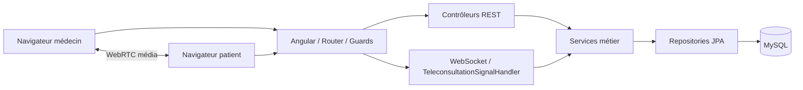
Le navigateur prend en charge l’interface, les permissions média et la connexion pair à pair. Le serveur contrôle les droits, la session applicative, la persistance des notes et messages, et relaie les informations de négociation.

## 2. Cycle d’un rendez-vous vidéo

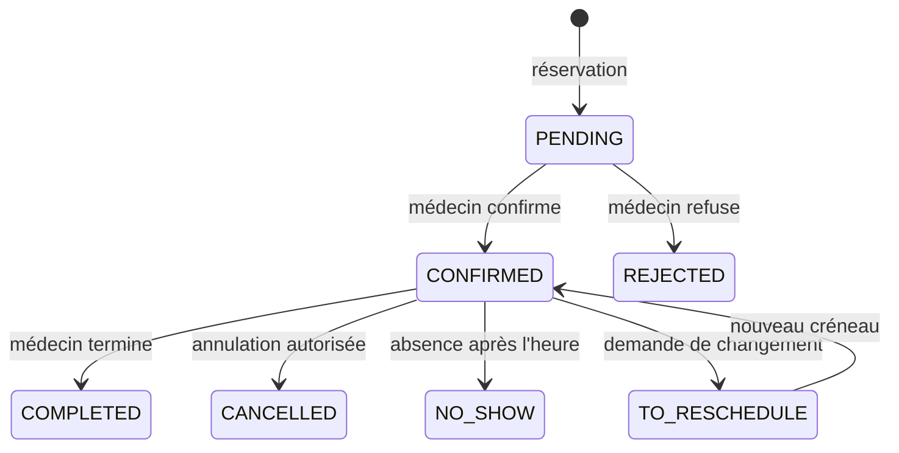
Les transitions sont vérifiées dans AppointmentService. Le rendez-vous et la session vidéo sont des états distincts.

## 3. Ouverture médecin avant l’heure

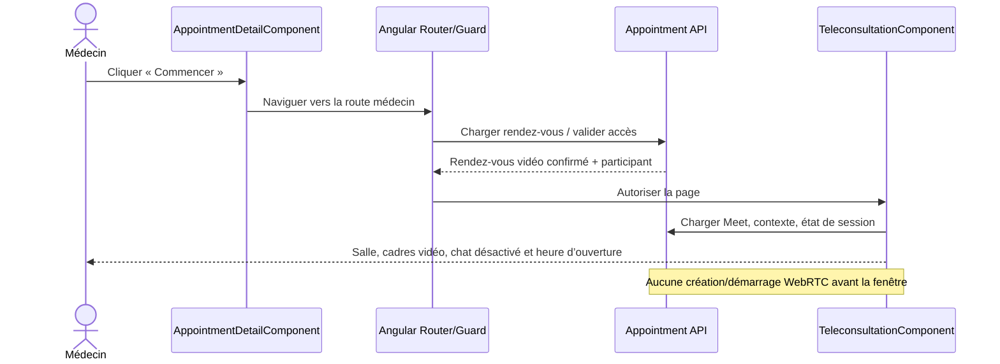
Le code documenté sépare l’affichage de la salle et l’ouverture de session. Le guard valide identité, propriété, statut et mode.

## 4. Ouverture patient

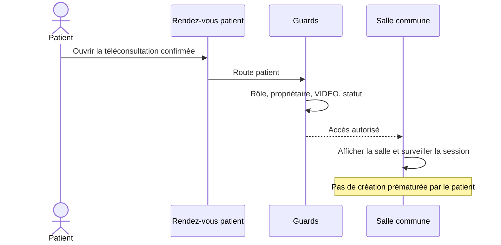
La route utilise le même composant de salle que le médecin; les commandes varient selon le rôle.

## 5. Fenêtre de téléconsultation

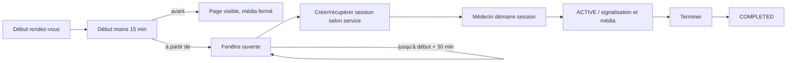
TeleconsultationService applique startAt moins 15 minutes jusqu’à startAt plus 30 minutes.

## 6. Démarrage WebRTC

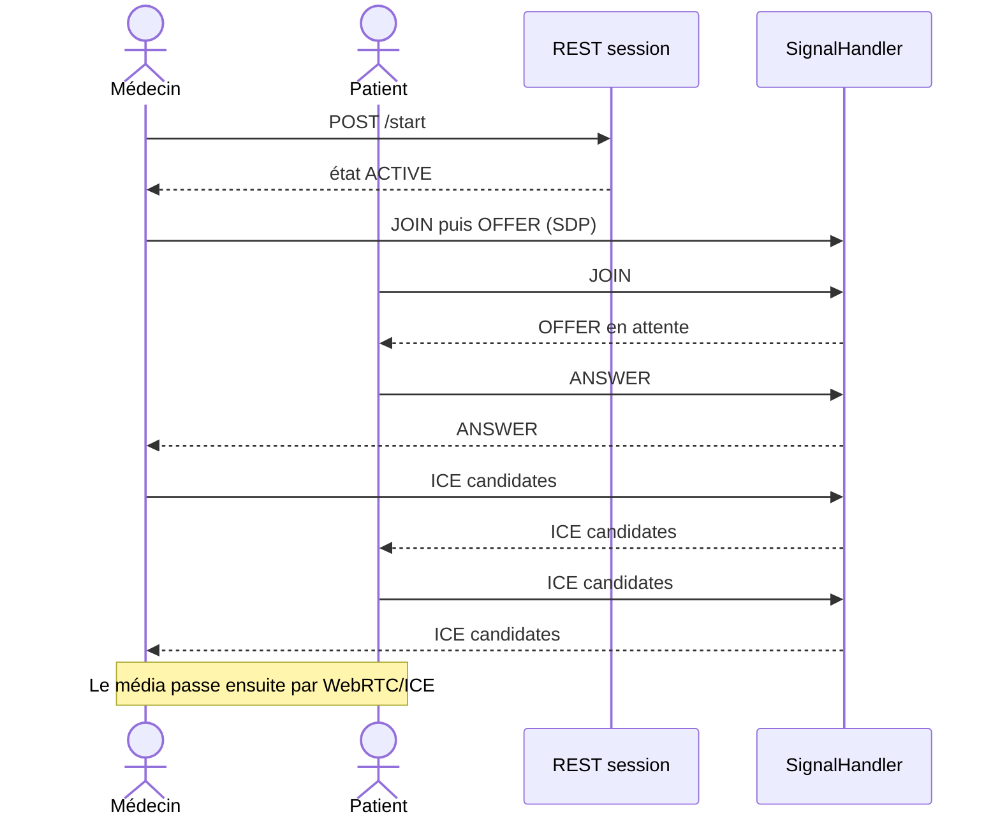
Le serveur relaie les signaux, mais ne mélange pas les flux vidéo.

## 7. Chat temps réel et persistance

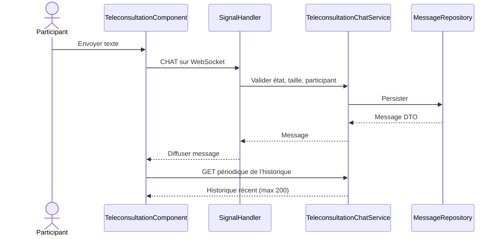
L’API REST POST existe également; l’interface actuelle privilégie le WS pour l’envoi. La synchronisation REST périodique s’exécute toutes les trois secondes environ.

## 8. Authentification et CSRF

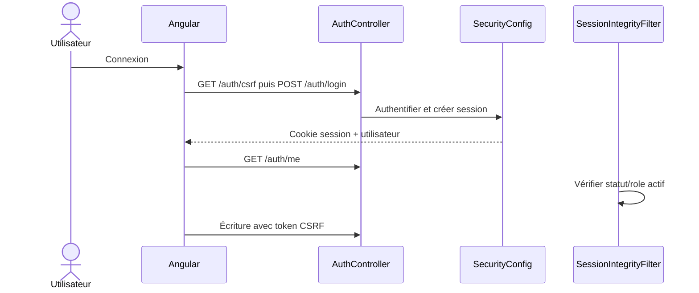
Les détails de cookie et CORS dépendent de la configuration d’exécution.

## 9. Guards Angular

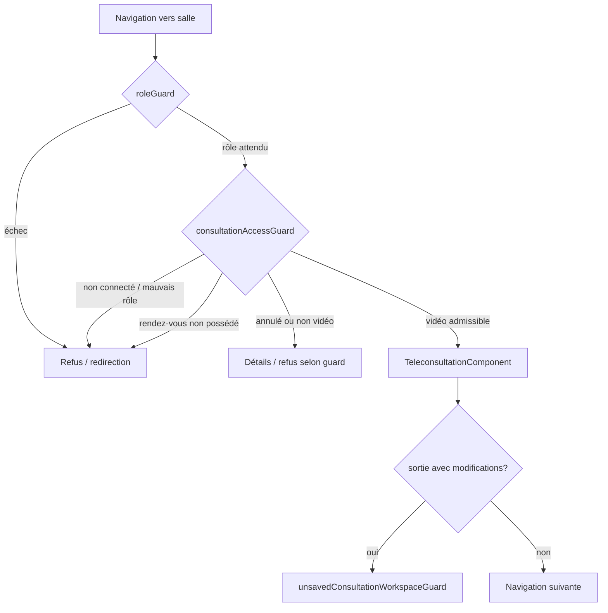
Le serveur répète les vérifications de propriété et de statut.

## 10. Note médicale

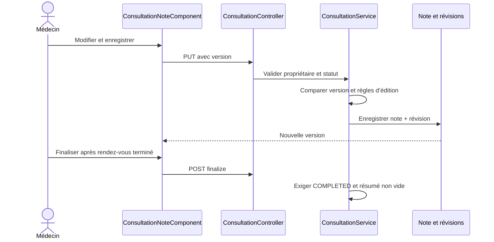
Une version périmée produit un conflit plutôt qu’un écrasement silencieux.

## 11. Ordonnance

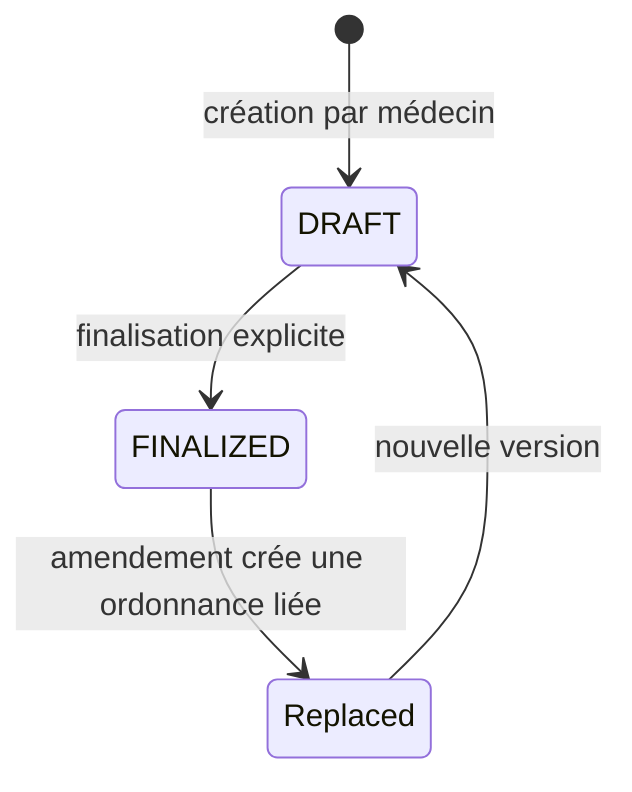
L’amendement crée un nouvel objet référençant l’original. Le patient voit les prescriptions finalisées liées à des consultations terminées.

## 12. Dossier médical

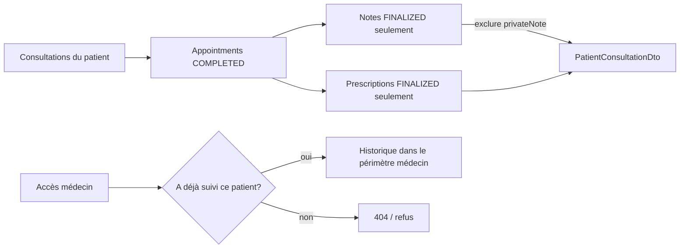
Le dossier décrit ici ne contient pas d’import de pièces médicales.

## 13. Google Meet

```mermaid
sequenceDiagram
  actor M as Médecin
  participant UI as Espace de travail
  participant API as AppointmentMeetLinkController
  participant S as AppointmentMeetLinkService
  M->>UI: Saisir URL
  UI->>API: PUT meet-link
  API->>S: Vérifier propriétaire, vidéo, statut, URL
  S->>S: Autoriser HTTPS meet.google.com
  S-->>UI: URL persistée
  M->>API: POST external-call-ended
  Note over API,S: Marqueur applicatif; ne pilote pas Google Meet
```
HelloDoc ne crée pas de conférence Google Meet ni ne mesure sa connectivité.

## 14. Suivi clinique

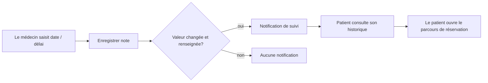
La recommandation ne réserve pas de rendez-vous automatiquement.

## 15. Contrôles d’accès backend

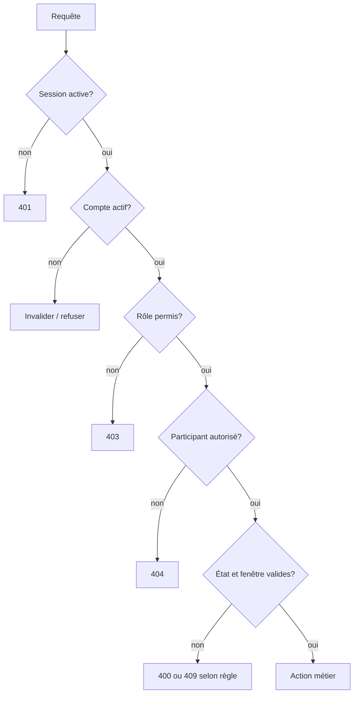
Les codes exacts sont propres à chaque service et contrôleur.

## 16. Routes frontend

```mermaid
flowchart LR
  Patient[Patient] --> RP[/patient/rendez-vous/:id/teleconsultation]
  Doctor[Médecin] --> RD[/medecin/rendez-vous/:id/teleconsultation]
  RP --> Shared[TeleconsultationComponent]
  RD --> Shared
  Shared --> Note[ConsultationNoteComponent]
```
Il y a deux URL selon le rôle mais une page de salle partagée. Le clic médecin conserve le bouton « Commencer la téléconsultation » sur les détails.

## 17. Persistances concernées

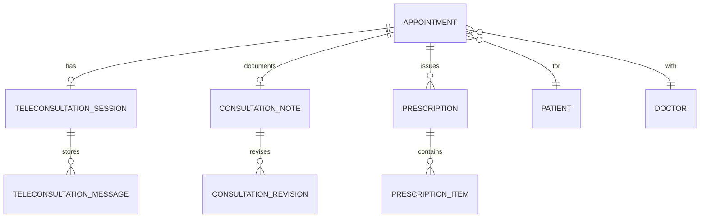
Ce diagramme est logique : il ne remplace pas les annotations JPA ni le schéma MySQL déployé.
