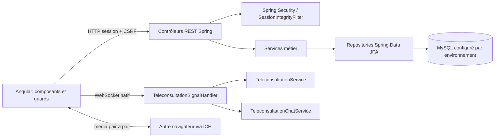

# HelloDoc — guide technique Sprint 4

> État documentaire établi à partir du code présent dans le dépôt. Les noms de classes et routes ci-dessous sont vérifiables dans les chemins cités. Ce guide ne prétend pas décrire un déploiement ni des capacités absentes du code.

## 1. Périmètre technique

Le Sprint 4 couvre ici l’espace de travail de téléconsultation, la signalisation WebRTC et le chat de session, le lien externe Google Meet, la note clinique, l’ordonnance et la consultation du dossier médical. Les modules transverses d’authentification, rendez-vous et disponibilité sont décrits lorsqu’ils conditionnent ces parcours.

Le dépôt est organisé en `frontend/` (Angular) et `backend/` (Spring Boot). Le backend s’appuie sur MySQL en configuration normale. Il n’existe pas de dépôt Android dans cet espace; une compatibilité d’un éventuel client Retrofit ne peut donc pas être affirmée.

## 2. Versions et dépendances

### Backend

Le parent Maven est Spring Boot 3.5.7 et le projet cible Java 21 (`backend/pom.xml`). Dépendances déclarées : Spring Web, WebSocket, Security, Data JPA, Validation et Mail; pilote MySQL à l’exécution; H2 et `spring-boot-starter-test`, `spring-security-test`, Mockito pour les tests. La couche HTTP est REST; la signalisation est un WebSocket natif.

### Frontend

`frontend/package.json` déclare Angular 20.3.x, TypeScript 5.9.x, RxJS 7.8.x, `zone.js` et les outils Angular CLI/build. Il n’y a pas de paquet npm WebRTC ou STOMP déclaré : le navigateur fournit `RTCPeerConnection`, `getUserMedia` et `WebSocket`.

Scripts présents : `start`, `start:qa`, `build`, `test:booking`, `test:approval`, `test:appointments`, `test:clinical`, `test:consultation-workspace`, `test:agenda-account`, `test:doctor-editors`. Ces scripts Node ciblent des contrôles frontend dédiés; ils ne sont pas tous un test Angular TestBed.

## 3. Architecture et responsabilités

Les contrôleurs traduisent HTTP en appels de services. Les services appliquent les règles métier et de propriété; les repositories portent la persistance. La signalisation WS vérifie l’accès à une session puis relaie SDP/ICE et les messages de chat. Le média audio/vidéo circule par WebRTC entre navigateurs lorsque la négociation réseau le permet; le serveur Java n’est pas un serveur média.

### Principales classes du périmètre

| Couche | Classes | Responsabilité constatée |
|---|---|---|
| REST | `AppointmentController`, `TeleconsultationController`, `TeleconsultationChatController`, `AppointmentMeetLinkController` | Rendez-vous, session vidéo, historique/message REST et Meet |
| REST clinique | `ConsultationController`, `PrescriptionController`, `PatientClinicalController` | Note, dossier médecin, ordonnance, vue patient |
| Services | `AppointmentService`, `TeleconsultationService`, `TeleconsultationChatService`, `AppointmentMeetLinkService`, `ConsultationService`, `PrescriptionService`, `PatientClinicalService` | Autorisation et invariants métier |
| Persistance | `Appointment`, `TeleconsultationSession`, `TeleconsultationMessage`, `ConsultationNote`, `ConsultationRevision`, `Prescription`, `PrescriptionItem`, `AppointmentStatusHistory` | Agrégats et historique métier |
| Frontend | `TeleconsultationComponent`, `ConsultationNoteComponent`, `AppointmentDetailComponent` | Salle, saisie clinique, détails et actions rendez-vous |
| Frontend sécurité | `roleGuard`, `consultationAccessGuard`, `unsavedConsultationWorkspaceGuard` | Rôle, éligibilité salle, avertissement sortie avec saisie non enregistrée |

## 4. Données et relations

`UserAccount` (table `users`) porte l’identité, le rôle et le statut actif; `Patient` et `Doctor` sont les profils associés. `Appointment` (`appointments`) lie un patient et un médecin, avec service/tarif, mode `IN_PERSON` ou `VIDEO`, instants de début/fin, statut, motif, lien Meet éventuel et marqueurs de fin d’appel externe. L’identifiant est UUID; `@Version` protège certaines écritures concurrentes. Une clé de réservation unique `(doctor_id, reservation_key)` et les contrôles de créneau évitent la double réservation.

`AppointmentStatusHistory` garde les transitions de statut. `TeleconsultationSession` (`teleconsultation_sessions`) référence de façon unique un rendez-vous et son état `WAITING`, `ACTIVE` ou `COMPLETED`. `TeleconsultationMessage` (`teleconsultation_messages`) référence session et expéditeur; le texte est plafonné à 2 000 caractères.

`ConsultationNote` (`consultation_notes`) est unique par rendez-vous, contient résumé, observation, traitement, prochaine date/délai, consignes et note privée; l’état est `DRAFT` ou `FINALIZED` et la version est optimiste. `ConsultationRevision` conserve l’historique d’édition et les anciennes valeurs. `Prescription` (`prescriptions`) comporte statut brouillon/finalisée et référence de remplacement (`supersedes_id`); les lignes sont en `PrescriptionItem` (`prescription_items`).

Le schéma est géré par JPA avec `spring.jpa.hibernate.ddl-auto=update` dans `application.properties`. Aucun dossier de migration Flyway/Liquibase n’est présent. La connexion utilise les variables de configuration `HELLODOC_DB_*` définies par l’application; ne pas documenter de mot de passe réel.

## 5. Sécurité et accès

`SecurityConfig` protège les API et utilise une session Spring avec cookie, CSRF via `CookieCsrfTokenRepository` et gestionnaire SPA. Les écritures HTTP doivent transmettre le token CSRF attendu. CORS autorise l’origine frontend configurée avec credentials. `SessionIntegrityFilter` réévalue statut actif et rôle pour les requêtes API et invalide une session révoquée.

Le frontend charge la route patient `/patient/rendez-vous/:appointmentId/teleconsultation` et la route médecin `/medecin/rendez-vous/:appointmentId/teleconsultation`, toutes deux avec `roleGuard` et `consultationAccessGuard`; la route médecin a aussi `unsavedConsultationWorkspaceGuard`. Le guard vérifie le rendez-vous via l’API, son mode vidéo, son statut admissible et que l’utilisateur connecté en est participant du rôle requis. Il ne dépend pas de la création d’une session WebRTC pour afficher la page.

Côté backend, `TeleconsultationService` répète les vérifications de propriété et d’éligibilité. Les accès à une ressource non possédée sont généralement masqués en 404; états incompatibles renvoient des erreurs 4xx. Le contrôle frontend améliore le parcours, mais n’est pas une frontière de sécurité.

## 6. API du parcours Sprint 4

Toutes les routes ci-dessous sont préfixées par `/api`. Les verbes et chemins viennent des annotations des contrôleurs. Authentification de session requise sauf indication contraire. Les requêtes d’écriture sont soumises à CSRF.

### Rendez-vous et disponibilité

| Verbe et chemin | Rôle | Usage |
|---|---|---|
| `POST /appointments` | USER/PATIENT | Créer une demande; réponse 201 |
| `GET /appointments/mine` | USER/PATIENT | Rendez-vous patient, pagination et vue historique |
| `GET /appointments/{id}` | participant | Détails si rendez-vous possédé |
| `POST /appointments/{id}/cancellation` | participant | Annulation avec motif |
| `PATCH /appointments/{id}/status` | DOCTOR | Confirmer/refuser/terminer selon transition permise |
| `GET /appointments/{id}/reschedule-options` | USER/PATIENT | Créneaux alternatifs |
| `PUT /appointments/{id}/reschedule` | USER/PATIENT | Reprogrammer |
| `POST /appointments/{id}/review` | USER/PATIENT | Avis après rendez-vous selon règles métier |
| `GET /doctors/me/appointments` | DOCTOR | Agenda médecin |
| `GET /doctors/{id}/slots?date=YYYY-MM-DD` | public | Créneaux disponibles |

### Salle, WebRTC, chat, Google Meet

| Verbe et chemin | Rôle | Usage / garde-fou |
|---|---|---|
| `GET /appointments/{id}/teleconsultation` | médecin/patient | Récupérer la session existante; peut répondre 404 si absente et 409 si hors fenêtre selon l’état |
| `POST /appointments/{id}/teleconsultation` | DOCTOR | Créer/récupérer une session; confirmé + vidéo et fenêtre contrôlée par le service |
| `GET /teleconsultations/{id}` | participant | Lire une session accessible |
| `POST /teleconsultations/{id}/start` | DOCTOR propriétaire | Passer WAITING à ACTIVE dans la fenêtre |
| `POST /teleconsultations/{id}/complete` | DOCTOR propriétaire | Terminer la session ACTIVE |
| `GET /teleconsultations/{id}/ice-config` | participant | Configuration STUN et éventuels identifiants TURN temporaires |
| `GET /teleconsultations/{id}/messages` | participant | Historique paginé/limité aux 200 derniers messages |
| `POST /teleconsultations/{id}/messages` | participant | Envoi REST disponible, même service de validation |
| `WS /api/teleconsultation-signal` | participant authentifié | JOIN, OFFER, ANSWER, ICE, CHAT; message limité à 64 Ko |
| `GET /appointments/{id}/meet-link` | participant | Lire le Meet selon mode, statut et règles temporelles |
| `PUT /appointments/{id}/meet-link` | DOCTOR propriétaire | Enregistrer lien Meet validé |
| `DELETE /appointments/{id}/meet-link` | DOCTOR propriétaire | Supprimer le lien |
| `POST /appointments/{id}/meet-link/external-call-ended` | DOCTOR propriétaire | Marquer l’appel externe terminé; ne termine pas automatiquement le rendez-vous |

Les réponses API sont des DTO, notamment `TeleconsultationDto`, `TeleconsultationMessageDto`, `IceServerDto`, `MeetLinkDto` et `AppointmentDto`. Erreurs courantes : 401 session absente/révoquée, 403 rôle interdit, 404 ressource non possédée/absente, 409 règle d’état ou de fenêtre, 400 validation.

### Dossier, note et ordonnance

| Verbe et chemin | Rôle | Usage |
|---|---|---|
| `GET /appointments/{id}/consultation-note` | DOCTOR propriétaire | Lire note |
| `PUT /appointments/{id}/consultation-note` | DOCTOR propriétaire | Enregistrer brouillon; contrôle de version |
| `POST /appointments/{id}/consultation-note/finalize` | DOCTOR propriétaire | Finaliser après consultation complétée et résumé présent |
| `GET /appointments/{id}/consultation-note/history` | DOCTOR propriétaire | Révisions récentes |
| `GET /appointments/{id}/clinical-context` | DOCTOR propriétaire | Contexte clinique du patient pour ce rendez-vous |
| `GET /doctors/me/patients` | DOCTOR | Patients avec consultations terminées avec ce médecin |
| `GET /doctors/me/patients/{id}` | DOCTOR | Dossier de patient dans le périmètre de ce médecin |
| `POST /appointments/{id}/prescriptions` | DOCTOR propriétaire | Créer une ordonnance brouillon |
| `GET /appointments/{id}/prescriptions` | DOCTOR propriétaire | Lire les ordonnances de ce rendez-vous |
| `PUT /prescriptions/{id}/amend` | DOCTOR propriétaire | Créer une version amendée liée à la précédente |
| `POST /prescriptions/{id}/finalize` | DOCTOR propriétaire | Finaliser |
| `GET /patients/me/consultations` | USER/PATIENT | Historique patient, notes/ordonnances finalisées seulement |

`PatientClinicalService` exclut explicitement la note privée. Il n’existe pas dans ce périmètre d’import de documents médicaux scannés : le dossier visible est composé des données de consultation et prescriptions.

## 7. Flux métier et temporels

### Ouverture de la salle et démarrage vidéo

Le clic médecin sur « Commencer la téléconsultation » navigue vers la route de salle; il ne doit pas créer une session à ce stade. Le guard valide l’identité, la propriété, le statut CONFIRMED/COMPLETED admissible et le mode VIDEO. La salle charge le rendez-vous et les éléments disponibles. Si aucune session n’existe, l’interface attend; la création est sollicitée seulement quand la fenêtre s’ouvre. La fenêtre de session est `startAt - 15 min` à `startAt + 30 min` dans `TeleconsultationService`. Le démarrage exige ensuite une session WAITING et médecin propriétaire; l’état passe ACTIVE avant l’échange WebRTC.

Exemple de rendez-vous 15 h 30 : salle consultable dès que le rendez-vous vidéo confirmé est autorisé, affichage du compte à rebours avant 15 h 15; la création/démarrage reste bloquée avant 15 h 15. Les contrôles de fenêtre existent aussi côté backend : l’horloge navigateur seule ne donne aucun droit.

### Négociation WebRTC et signalisation

Le composant obtient les ICE servers depuis l’API puis demande caméra/micro via `getUserMedia`. Il ouvre `RTCPeerConnection` et WebSocket. Le médecin crée l’offre SDP; le patient reçoit l’offre et renvoie une réponse; les candidats ICE sont échangés. Les flux sont accrochés aux éléments vidéo par `ontrack`. Une connexion ICE peut nécessiter TURN; les URL/secret TURN sont optionnels en configuration. Le backend fournit une identité TURN temporaire d’une heure si un secret est configuré.

### Chat

Le composant charge l’historique REST et interroge périodiquement le serveur (intervalle observé : 3 s). L’envoi interactif passe par un message WS `CHAT`; le handler valide l’état ACTIVE et délègue la persistance à `TeleconsultationChatService`, puis diffuse le message. La réception est dédupliquée par identifiant; le rafraîchissement REST resynchronise la liste. Le serveur refuse un contenu vide ou supérieur à 2 000 caractères et refuse l’envoi après COMPLETED. Ne pas confondre ce canal applicatif avec un transport STOMP : aucun STOMP n’est déclaré.

### Google Meet

Le médecin peut associer un lien HTTPS `meet.google.com` après validation stricte de l’hôte et du chemin. L’application ne crée pas de conférence Google Meet et n’observe pas son état réseau. Le marqueur « appel externe terminé » est saisi côté HelloDoc; un WebRTC actif empêche cette déclaration. Il ne clôt pas à lui seul le rendez-vous.

### Note médicale et ordonnance

La note est modifiable pour rendez-vous CONFIRMED ou COMPLETED par le médecin propriétaire. Les sauvegardes successives exigent la version courante; une modification d’une note finalisée demande un motif et produit une révision. La finalisation de note exige un rendez-vous COMPLETED et un résumé non vide. La prochaine date doit respecter les contraintes de date en zone `Africa/Tunis`; une notification de suivi n’effectue pas de réservation.

Une ordonnance peut être créée en brouillon pour un rendez-vous confirmé/terminé. Une correction produit une nouvelle ordonnance qui référence l’ancienne; la finalisation est une action distincte. Le patient ne voit que les consultations terminées, les notes et ordonnances finalisées.

## 8. Temps, configuration et limites constatées

Les rendez-vous sont stockés en `Instant` (UTC côté JDBC configuré); les règles métier de jour et de suivi utilisent `Africa/Tunis`. L’écran doit donc afficher des dates converties selon la zone voulue. La fenêtre de téléconsultation est calculée à partir de l’heure de début et tolère jusqu’à 30 minutes après celle-ci.

`application.properties` décrit le datasource par variables d’environnement, `ddl-auto=update`, l’origine frontend et les réglages STUN/TURN. Aucun secret ne doit être copié depuis un environnement local dans la documentation.

Limites visibles dans le code : TURN n’est pas utilisable sans URL(s) et secret; Meet est un lien externe; pas de serveur média; la reconnexion signalisation n’est pas une garantie automatique (le parcours prévoit une possibilité de réessai/rejoindre); la consultation du patient filtre sur les éléments finalisés; pas d’upload de pièces médicales dans le dossier Sprint 4; pas de migration versionnée trouvée. Ces constats décrivent le dépôt, pas une promesse produit générale.

## 9. Fichiers repères

- Frontend : `frontend/src/app/app.routes.ts`, `frontend/src/app/features/appointments/appointment-detail.component.ts`, `teleconsultation.component.ts`, `consultation-note.component.ts`, `frontend/src/app/core/guards/`.
- Backend : `backend/src/main/java/com/hellodoc/controller/`, `service/TeleconsultationService.java`, `service/TeleconsultationChatService.java`, `service/ConsultationService.java`, `service/PrescriptionService.java`, `service/PatientClinicalService.java`.
- Signalisation : `config/TeleconsultationWebSocketConfiguration.java`, `websocket/TeleconsultationSignalHandler.java`.
- Configuration : `backend/src/main/resources/application.properties`, `backend/pom.xml`, `frontend/package.json`.
- Tests backend : `backend/src/test/java/com/hellodoc/`; scripts frontend : `frontend/scripts/`.
